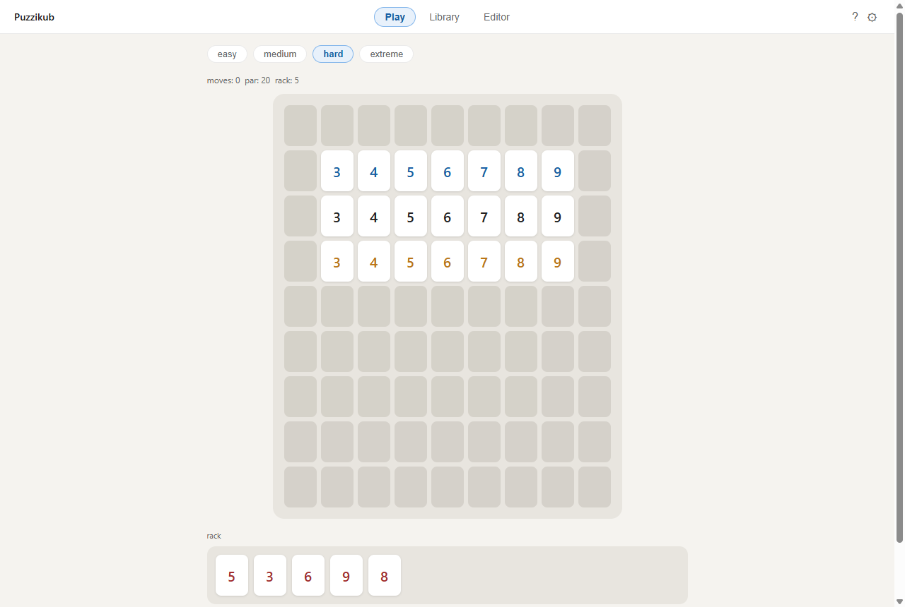
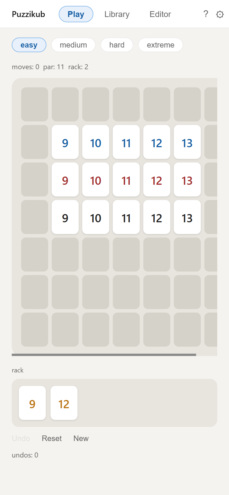
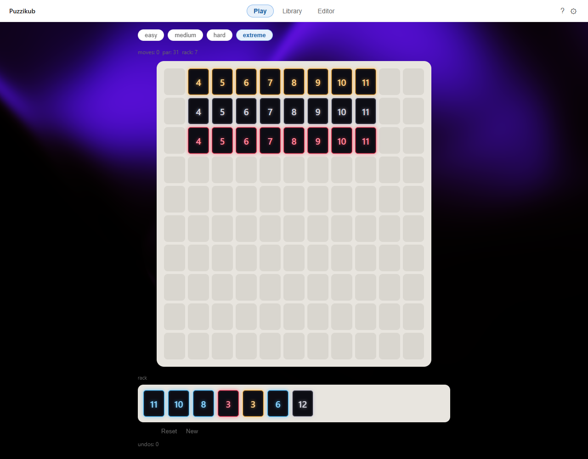

# Puzzikub

Puzzikub is a single-player tile puzzle inspired by Rummikub: every puzzle starts
from a valid board and a small rack, and you clear the rack by rearranging the
board into new valid sets. Puzzles are generated in the browser and each one
comes with a par. Puzzikub is an independent fan project and is **not affiliated
with or endorsed by** the makers of Rummikub.

**Play it: [iangopen.github.io/puzzikub](https://iangopen.github.io/puzzikub/)**



## How to play

- Tiles carry a number from 1 to 13 in one of four colours. A puzzle may hold up
  to two copies of the same tile.
- A **run** is three or more tiles of one colour with consecutive numbers
  (`4 5 6 7`). A **group** is three or four tiles with the same number and all
  different colours.
- Sets are read **horizontally**: each unbroken stretch of tiles in a row must
  be a valid run or group.
- Drag rack tiles onto the board. You may also move any board tile; dropping it
  on another tile swaps the two. Each drop counts as one move.
- You win when the rack is empty and every set on the board is valid. The
  obvious placement never works: building new sets means taking apart ones that
  are already valid.
- **Par** is the move count of the solution the generator built the puzzle
  around. It is a target, not a proven minimum. Undo and Reset are always
  available.
- Four difficulties: easy, medium, hard and extreme.

| Phone (touch) | Neon theme |
|---|---|
|  |  |

## Features

- **Generated puzzles** from several construction "archetypes", including
  puzzles with a tempting dead-end move and puzzles that need a chain of
  deductions.
- **Five theme presets** (Minimalist, Glass, Wood, Neon, Paper), light and dark
  mode, sound effects (Web Audio synthesis) and a board-size setting
  (50% to 125%).
- **Touch support**: drag with a finger, and pan wide boards by swiping empty space.
- **Library**: save puzzles, generate new ones at any difficulty, replay or
  delete them. Stored in your browser's `localStorage`.
- **Editor**: build your own board and rack, then save the puzzle to the Library.

## Stack

React 19 · TypeScript · Vite 8 · [ogl](https://github.com/oframe/ogl) (WebGL,
for the animated background only). It is a static site deployed to GitHub Pages
with [gh-pages](https://github.com/tschaub/gh-pages). There is no backend.

## Quick start

Requires Node.js (the browser checks need Node 22+ for its built-in
`WebSocket`, plus a local Chrome or Edge).

```sh
git clone https://github.com/iangopen/puzzikub.git
cd puzzikub
npm install
npm run dev        # http://localhost:5173/puzzikub/
npm run build      # type-check + production build into dist/
npm run preview    # serve dist/ at http://localhost:4173/puzzikub/
```

## How the engine is verified

All game logic lives in `src/lib/` as plain TypeScript with no React, so it can
be checked directly. Every generated puzzle must pass four rules:

1. The starting board is already valid.
2. The board and rack together can be split into valid sets. A solver checks
   this exactly.
3. The rack cannot form a valid set on its own, so you can't just lay it down
   as a new row.
4. Dropping each rack tile into its most obvious spot without touching the board
   does **not** win.

Twelve standalone check scripts (no test framework) re-verify these rules on
freshly generated puzzles. They also confirm that each trap really is a dead
end, that par matches a simulated playthrough, and that the solver agrees with
an independent second solver. Browser checks drive a real headless Chrome
through the Chrome DevTools Protocol, including genuine touch events.

```sh
npm run verify         # build + lint + engine checks + browser checks (~6 min)
npm run verify:full    # the same, plus the slowest planner check (~8 min)
npm run verify:live    # smoke-test the deployed site
```

## Repository layout

```
src/lib/          game engine: solver, validator, puzzle builders, generator,
                  storage, and the *.verify.ts check scripts
src/hooks/        game state, drag handling, editor state
src/components/   board, rack, tiles, settings, tutorial, background
src/screens/      Play, Library and Editor screens
scripts/          browser verification rig (Chrome DevTools Protocol, no deps)
docs/             screenshots and project history
```

Design notes and measured results are in `CLAUDE.md`, `GENERATOR_AUDIT.md` and
the `*_DESIGN.md` files.

## Credits

- **DarkVeil** animated background (the Neon theme) is from
  [React Bits](https://reactbits.dev/backgrounds/dark-veil) by David Haz, used
  under the React Bits license (MIT + Commons Clause). The license notice is in
  [`src/components/DarkVeil.tsx`](src/components/DarkVeil.tsx).
- [**ogl**](https://github.com/oframe/ogl), the WebGL library DarkVeil renders
  with, is released under the Unlicense (public domain).
- Rummikub is a trademark of its respective owner. It is mentioned here only to
  describe the genre.
